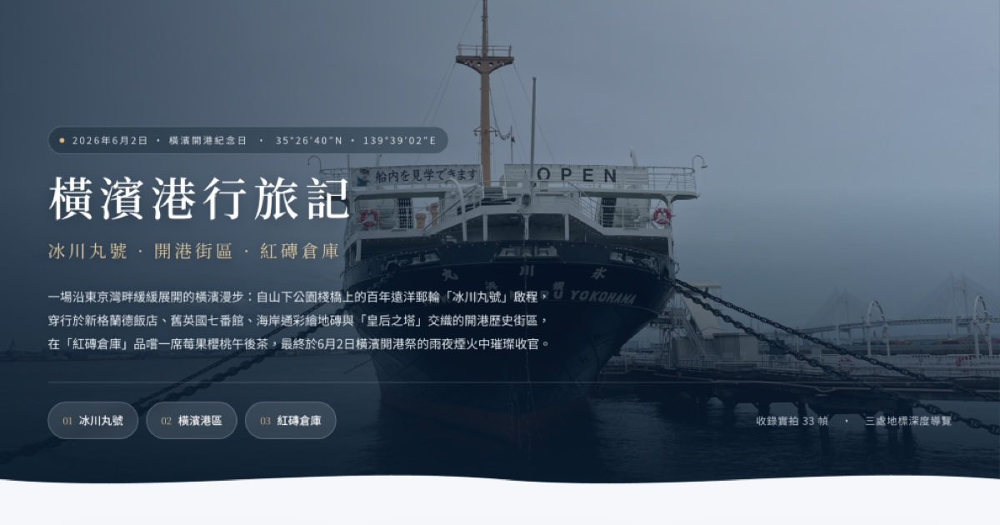
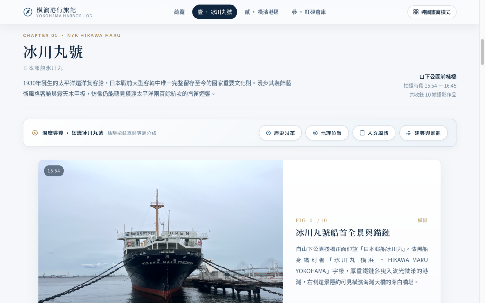

# 橫濱港行旅記（Yokohama Harbor Log）

  

🌐 **線上網站**：https://agneschaorl-stack.github.io/yokohama-harbor-log/

以橫濱開港紀念日（6月2日）實地拍攝的 33 幀攝影作品為核心，結合海洋風味與典雅排版打造的靜態攝影瀏覽網頁。支援 iOS / Android「加入主畫面」安裝為專屬 App 圖示。

## 內容篇章

1. **壹 · 冰川丸號（NYK Hikawa Maru）**：10 幀實拍，含船首全景與錨鏈、一等客室、彩繪鸚鵡花窗社交室、前甲板高桅、9 號船長室、露天散步甲板、1/100 精密船模與百年白燈台。
2. **貳 · 橫濱港區與開港祭煙火（Port of Yokohama）**：17 幀實拍，串聯新格蘭德飯店、山百合開港紀念碑、舊英國七番館（戶田平和紀念館）、海岸通彩繪瓷磚畫、橫濱稅關「皇后之塔」，以及 6 月 2 日開港祭雨夜花火。
3. **參 · 橫濱紅磚倉庫（Yokohama Red Brick Warehouse）**：6 幀實拍，涵蓋紅磚廣場與海灣大橋中軸遠景、GREEN×EXPO 2027 吉祥物雕塑，以及館內 `à la campagne` 午後茶歇。

## 網頁特色

- **互動地標深度導覽**：三處地標皆附有「歷史沿革」「地理位置」「人文風情」「建築與景觀」互動按鈕，點擊即可展開專題閱讀並自由切換。
- **雙瀏覽模式**：支援「圖文雅覽」與「純圖畫廊模式」一鍵切換。
- **全螢幕大圖燈箱**：點擊任意照片可賞閱高畫質原圖，並支援鍵盤 `←` / `→` / `Esc` 操作。
